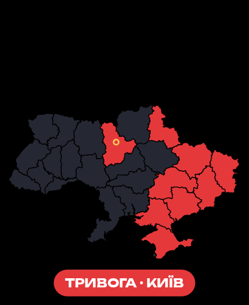
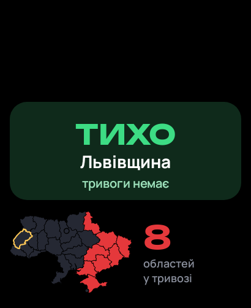
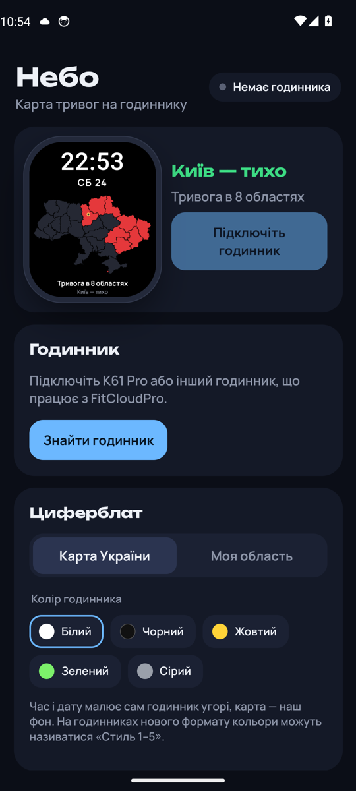

# Небо

Карта повітряних тривог прямо на циферблаті смарт-годинника. Зроблено для **K61 Pro**, має працювати й з іншими годинниками, які підключаються через **FitCloudPro**.

«Небо» саме підключається до годинника через офіційний FitCloudPro SDK, малює циферблат із картою тривог і оновлює його, коли тривоги змінюються. Час і дату показує сам годинник, тож вони завжди точні.

[Завантажити APK](https://github.com/hatogg/Nebo/raw/main/apk/Nebo-1.1.apk)

<p align="center">
  
  
  
</p>

## Що вміє

- **Карта по районах, як на офіційній.** Тривоги оголошують по районах, тож «Небо» малює всі 136 районів: червоний — повітряна тривога, темно-червоний — тривога лише в частині району (громада чи місто), жовтий — **жовтий рівень** (загроза дронів), бордовий — відбій був менше 20 хвилин тому.
- **Два циферблати на вибір.** «Карта України» — уся карта, ваш район чи область обведені білим. «Моя область» — великий статус («ТРИВОГА», «ЗАГРОЗА» або «ТИХО») з часом початку і міні-карта з кількістю областей у тривозі.
- **Свій район.** Можна обрати район (точніше) або всю область.
- **Оновлюється сам.** Тривоги перевіряються кожні 15 секунд. Зміна у вашому районі — новий циферблат одразу, зміни в інших — не частіше ніж раз на 30 секунд (або 1 чи 3 хвилини, як оберете). Якщо нічого не змінилось, циферблат не перезаписується — він і так актуальний.
- **Вібрація на годиннику.** Тривога, жовтий рівень і відбій у вашому районі приходять сповіщенням на годинник і телефон.
- **Пересилає сповіщення телефона.** Поки годинник прив'язаний до «Неба», FitCloudPro не працює, тому «Небо» саме передає на годинник Telegram, Viber, SMS, дзвінки та інші сповіщення.
- **Колір годинника.** П'ять стилів цифр з офіційних шаблонів FitCloud. На годинниках формату GUI колір змінюється миттєво, без повторного надсилання циферблата.
- **Журнал для розробника** — якщо щось не працює, його можна надіслати одним натисканням.
- Без реклами й трекерів, інтерфейс українською.

## Як підключити

1. У FitCloudPro відв'яжіть годинник або просто закрийте FitCloudPro (годинник може бути на зв'язку лише з одним застосунком).
2. Відкрийте «Небо», дайте дозвіл на Bluetooth і сповіщення.
3. «Знайти годинник» → оберіть свій → «Прив'язати». Якщо годинник попросить підтвердження — натисніть «так» на ньому.
4. Оберіть свою область і стиль циферблата, натисніть «Надіслати на годинник».

Щоб тривоги приходили вчасно, увімкніть «Робота у фоні без обмежень».

> Під час прив'язки годинник очищає кроки, сон і пульс, збережені на ньому, — так працює протокол FitCloud при зміні застосунку. Повернутися до FitCloudPro можна будь-коли: «Відв'язати» в «Небі» і прив'язати годинник у FitCloudPro.

## Як це працює

- Дані про тривоги — відкрите API [ubilling.net.ua/aerialalerts](https://wiki.ubilling.net.ua/doku.php?id=aerialalertsapi) без ключа: основне джерело — дані alerts.in.ua з рівнями по районах і громадах, запасне — стан областей. Джерело неофіційне: для важливих рішень користуйтеся офіційним застосунком «Повітряна тривога».
- Карту «Небо» малює на телефоні, бере шаблон власного циферблата з сервера FitCloud — той самий, що використовує FitCloudPro, — і записує туди свій фон через `DialWriter` з SDK. Потім надсилає циферблат на годинник по Bluetooth.
- Циферблат записується в слот для власних циферблатів і не затирає інші. Деякі годинники після запису одразу перезавантажують циферблат і рвуть зв'язок — «Небо» це враховує і саме перепідключається.

## Обмеження

- Кроки, сон і пульс «Небо» не показує й не синхронізує.
- Погоду на годинник поки не надсилає.
- Надсилання циферблата займає приблизно 20–60 секунд, у цей час годинник зайнятий. Під час масованих атак, коли райони змінюються щохвилини, інтервал 30 секунд помітно розряджає годинник — тоді краще обрати 1–3 хвилини.
- Перевірено на K61 Pro: прив'язка й надсилання циферблата працюють. Автоматичні тести в емуляторі Android на кожній збірці перевіряють циферблати, інтерфейс і отримання тривог.

## Збирання

Потрібні JDK 17 і Android SDK.

```bash
./get-sdk.sh                 # завантажує AAR FitCloudPro SDK у app/libs
./gradlew assembleRelease
```

GitHub Actions збирає APK на кожен push, запускає застосунок в емуляторі й зберігає зразки циферблатів і скріншоти в гілку `ci`. Щоб підпис APK не змінювався між збірками, додайте секрет `NEBO_KEYSTORE_B64` (keystore PKCS12 у base64, псевдонім `nebo`) і за потреби `NEBO_STORE_PASS`.

## Ліцензії та джерела

- FitCloudPro SDK — [htangsmart/FitCloudPro-SDK-Android](https://github.com/htangsmart/FitCloudPro-SDK-Android) (не входить у репозиторій, завантажується скриптом).
- Межі областей — © учасники OpenStreetMap (ODbL), через [EugeneBorshch/ukraine_geojson](https://github.com/EugeneBorshch/ukraine_geojson).
- Межі районів і громад — [slawomirmatuszak/ukrainian_geodata](https://github.com/slawomirmatuszak/ukrainian_geodata) (CC BY 4.0).
- Шрифти Unbounded і Manrope — SIL Open Font License.

---

<sub>🇬🇧 **Nebo** shows a live Ukrainian air-raid alert map as the watch face of FitCloudPro smartwatches (K61 Pro and similar). It connects to the watch through the official FitCloudPro SDK, renders the map on the phone, pushes it as a custom watch face whenever alerts change (raion level, red and yellow threat levels), vibrates the watch when your raion gets an alert, and forwards phone notifications. Alert data: ubilling.net.ua open API (unofficial).</sub>
